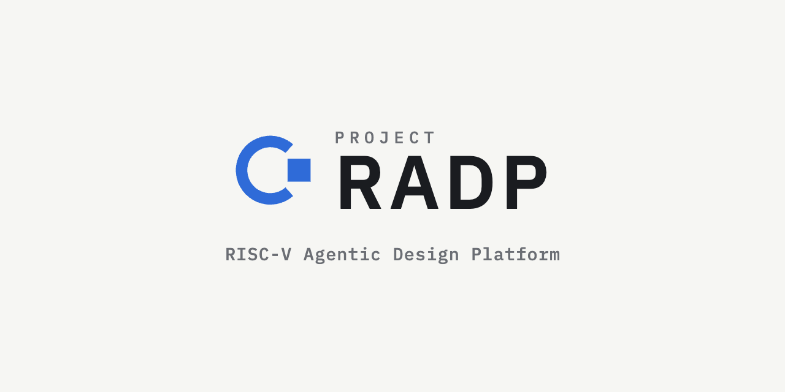

<p align="center">
  
</p>

<h3 align="center">AI agents design RISC-V cores. Open-source EDA tools verify them.</h3>

<p align="center">
  <a href="https://halid.org">Blog</a> ·
  <a href="https://github.com/Project-RADP/radp">Main repo</a> ·
  <a href="https://github.com/Project-RADP/radp/discussions">Discussions</a>
</p>

---

**Project RADP** (RISC-V Agentic Design Platform) is an open-source platform that takes a RISC-V processor from a single spec file to RTL, verification, synthesis, FPGA bitstream and shuttle tapeout, using AI agents for the work and deterministic open-source tools for every decision.

### Agents propose, tools decide

- **Spec-driven.** Everything starts from one versioned `chip.yaml`, validated against a JSON Schema.
- **Gated.** Every agent change on a Git branch passes lint, simulation, ISA compliance, lockstep against Spike, formal checks, coverage and timing before a human merges it.
- **Inspectable.** Every agent step records its inputs, tool calls, diff, gate result and cost.
- **Open toolchain only.** Verilator, cocotb, Spike, Sail, riscv-arch-test, SymbiYosys, Yosys, nextpnr, OpenROAD and LibreLane.
- **Sandboxed.** Rootless, network-isolated containers with pinned, reproducible tools.

### Pipeline

```
chip.yaml → RTL → lint → unit sim → compliance → lockstep → formal → coverage → synth/timing → FPGA / GDS
```

### Targets

| Target | Status |
| --- | --- |
| Lattice ECP5 FPGA | First milestone: spec to CoreMark on hardware |
| Sky130 / GF180 shuttles | Planned |
| IHP SG13G2 | Planned |

### Repositories

| Repo | Description |
| --- | --- |
| [`radp`](https://github.com/Project-RADP/radp) | Core platform: orchestrator, agents, tool contracts, web UI |
| [`radp-cores`](https://github.com/Project-RADP/radp-cores) | Reference RISC-V cores produced and verified by the pipeline |
| [`radp-evals`](https://github.com/Project-RADP/radp-evals) | Agent benchmarks and eval harness |

### Get involved

Project RADP is in early development. Feedback from RTL, verification and physical design engineers is especially welcome.

- Read the design notes and progress on the [blog](https://halid.org)
- Open an issue or start a discussion in the [main repo](https://github.com/ORG/radp)
- Contributions are licensed under **Apache-2.0** and require a CLA

<sub>Project RADP is an independent open-source project. RISC-V is a trademark of RISC-V International.</sub>
